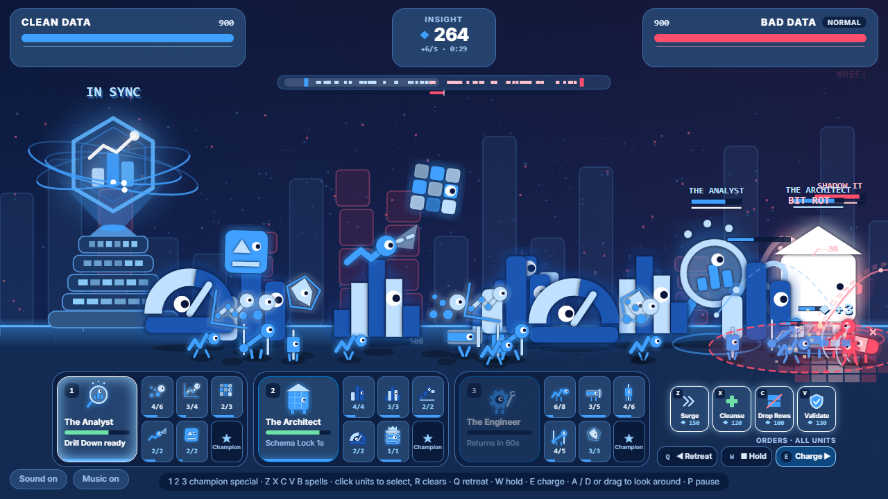

# Data Defense

A lane-battle game about deploying chart marks against Bad Data.

Your army of charts spawns by itself and marches on a corrupted data stack. You lead it: fire
your champions' specials, order units to retreat, hold or charge, cast spells, and choose which
units, champions and spells to bring to each battle.

**Play it on Tableau Public:** https://public.tableau.com/app/profile/joseph.besecker/viz/DDTest_17946081470490/DataDefense#2

That is a test link for now and will be replaced with the live one.

## Why this exists

I wanted to see how far I could push Tableau Data Apps, and to have something to play around
with while finding out. Apparently pretty far: a whole game, with a campaign, animation and
music, runs inside a dashboard.

## What this repository is

This repository holds only the built game: one self-contained `index.html`, served with GitHub
Pages so it can be embedded elsewhere (for example in a Tableau Public dashboard's Web Page object).
There are no image, sound or font files and no network calls: the art is drawn in code and the
music and sound effects are synthesized.

## What is in it

- **A 28-battle campaign** in three acts and an epilogue, on branching maps. The upper and lower
  routes award different units and spells.
- **36 units** in five families (Swarm, Guard, Marks, Area, Support), plus bonus units and three
  one-of-a-kind super units that are won by beating them. Every chart has its own data problem
  on the other side: Bar Stack and Duplicate, Pie Slice and Truncation, Source of Truth and Zero Day.
- **6 champions**, each with a special attack. You start with one and win the rest.
- **8 spells**, bought with Insight during a battle and limited by their cooldowns.
- **Three standing orders**: Retreat, Hold and Charge, for the whole army or any selection.
- **Base upgrades** that show on your tower, five music tracks, and a skirmish mode.

## How to play

| Keys | What they do |
|---|---|
| 1 2 3 | Fire a champion's special when it is charged |
| Z X C V B | Cast the spells you have equipped |
| Q W E | Retreat, Hold, Charge. Click units first to order only those; R clears the selection |
| A D, or drag | Look along the lane |
| P | Pause: volume and graphics settings are here |
| F | Show the frame rate |

Progress is kept in your browser. The campaign screen also shows a save code you can copy and
paste back in later, which is the only way to keep progress where browser storage is blocked.

If the game runs slowly, open the pause menu and set Graphics to **Fast**. Left on Auto, it
switches by itself when the frame rate drops.

## Acknowledgement

The structure of this game, an army that fields itself while you command champions, cast spells
and choose what to bring to each battle, was inspired by **Epic War 3 by Rudy Sudarto**. Thank you
for a design that still holds up. Data Defense is an original game: its theme, units, names, art,
numbers and battles are its own, and nothing was taken from Epic War.

## Status

An experiment, not a finished product. Difficulty has only been checked by scripted stand-in
players, so some battles will be too easy and some too hard. Saves from earlier versions do not
carry over. See [CHANGELOG.md](CHANGELOG.md) for what changed.

MIT licensed. Two base skins use the Tableau logo and the Eigen X mark, which belong to their owners and are not
covered by that licence.
